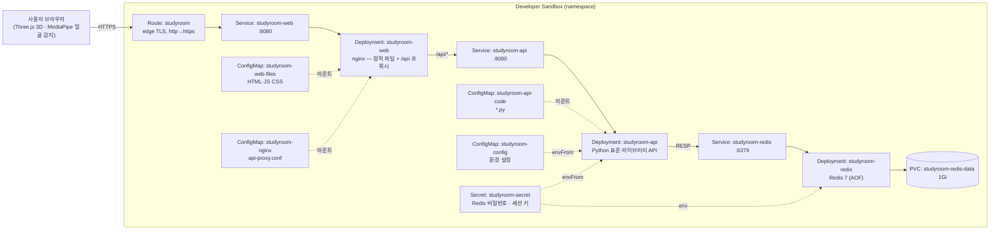

# StudyPals — 3D 온라인 스터디윗미

> 모여서 각자 공부하는 3D 공부방. 동물 캐릭터로 함께 앉아 공부하고, 카메라로 자리 비움을 감지해 **진짜 공부한 시간만** 기록합니다.


- 학번: 202355536
- 배포 대상: Red Hat Developer Sandbox (OpenShift)
- 구성: **Deployment 3개(web · api · redis) + Service 3개 + Route + ConfigMap 4개 + Secret + PVC**

---

## 1. 컨테이너 소개

| 항목 | 내용 |
|---|---|
| 서비스 이름 | StudyPals (공부 친구들) |
| 한 줄 설명 | 고정 시점 3D 공부방에 여러 사용자가 캐릭터로 앉아 함께 공부하고, 브라우저 내 얼굴 감지로 실제 공부시간을 기록하는 웹 서비스 |
| 주제 선정 이유 | 혼자 공부할 때는 동기 유지가 어렵고, 기존 스터디윗미는 영상과 타이머 위주입니다. "다른 사람이 지금 같이 공부하고 있다"는 느낌을 귀여운 3D 공간으로 보여 주고 싶었습니다. 또한 웹·API·DB가 나뉜 3계층 구조라 수업에서 배운 Object(ConfigMap, Secret, PVC, Probe)를 모두 의미 있게 써 볼 수 있는 주제입니다. |

### 주요 기능

| 기능 | 설명 |
|---|---|
| 간단 가입·로그인 | 아이디·비밀번호·닉네임만으로 가입합니다. 비밀번호는 PBKDF2 해시로만 저장합니다. |
| 캐릭터 | 🐻 곰 · 🐰 토끼 · 🐈‍⬛ 검은 고양이 · 🐱 하얀 고양이 · 🐶 갈색 강아지(리트리버처럼 처진 귀). 가입할 때 **랜덤**으로 정해집니다. **캐릭터 페이지**에서 고르면 3D 미리보기로 손을 흔드는 모습을 보여 주고, 저장해야 실제로 바뀝니다(🎲 랜덤 버튼도 있음). |
| 페이지 구성 | 상단 탭으로 **공부방**(방 목록·방 만들기 모달·코드 입장) · **플래너** · **캐릭터** 페이지를 오갑니다. 오른쪽 프로필 메뉴에서 캐릭터 바꾸기·로그아웃. |
| 공부방 | 공개방과 비공개방을 만들 수 있습니다. 비공개방은 **영문+숫자 6자리 코드**로만 들어갈 수 있고, 코드 입력은 분당 10회로 제한합니다. 방마다 4·6·8명 중에서 정원을 정합니다. |
| 3D 도서관 | 통유리 창, 양쪽 원목 책장과 그 위 벽 조명, 창가 라운지와 화분이 있는 **도서관**입니다. 책상마다 은행원 스탠드와 김이 나는 커피가 놓여 있습니다. 가운데 책상 섬에서 두 줄이 **서로 마주 보고** 앉고, 카메라는 두 줄의 얼굴이 모두 보이도록 옆에서 내려다봅니다. 빈 자리를 클릭하면 앉고, 다른 사람의 상태가 3초마다 반영됩니다. 3D 모델 파일 없이 기본 도형과 캔버스 텍스처만으로 만들었습니다. |
| 창밖 시간 | 창밖 하늘이 **보는 사람의 실제 시각**을 따라 새벽 → 해돋이 → 낮 → 노을 → 밤으로 바뀝니다. 해와 달이 창을 가로질러 움직이고, 햇빛 방향·색과 실내 조명 밝기도 함께 바뀝니다(1분마다 갱신). 주소에 `?time=18:30`을 붙이면 원하는 시각을 미리 볼 수 있습니다. |
| 캐릭터 상태 | 📖 공부 중(노트북 타이핑, 화면 켜짐) · 📱 자리 비움(폰 보기) · ☕ 휴식(기지개) · 💤 대기(엎드림) |
| 자리 감지 | 브라우저에서 5초마다 얼굴을 감지합니다. **최근 6번 중 4번 이상** 안 보이면 자리 비움으로 바뀌고 타이머가 멈춥니다. 카메라 영상은 서버로 보내지 않습니다. |
| 공부시간 | 서버가 하트비트 간격으로 누적합니다. 직전 상태가 공부 중일 때만 더하고, 하루 총합·과목별·**10분 칸별**로 기록합니다. 과목을 고르지 않으면 시간표의 지금 계획 과목으로 쌓입니다. |
| 플래너 | 종이 스터디 플래너처럼 **TODAY'S · D-DAY · TOTAL TIME · 오늘의 한마디 · CONTENTS · TIMETABLE**을 한 장에 담았습니다. 과목별 할 일 목록에서 골라 오늘 할 일(CONTENTS)에 담고 완료하면 O를 표시합니다. **시간표**는 6시~다음 날 5시를 10분 칸으로 나눠, 과목을 고르고 드래그로 칠해 시간대별 계획을 세웁니다. 실제로 공부한 10분 칸에는 진한 막대가 표시됩니다. ◀ ▶와 **최근 7일** 막대로 지난 날짜를 읽기 전용으로 볼 수 있습니다. |
| 3D 연동 | 캐릭터 이름표 아래에 **지금 시각에 시간표로 계획한 과목과 할 일**이 표시됩니다(예: 운영체제 · 3장 프로세스 정리). 오늘 남은 할 일 수만큼 책상 위에 과목 색의 책이 쌓이고, 펼친 책은 지금 공부하는 과목의 색이 됩니다. 책상 스탠드는 아침·낮에는 꺼지고 노을부터 켜집니다. |
| lo-fi 음악 | Web Audio로 코드 진행, 드럼, 바이닐 노이즈를 직접 만들어 재생합니다. 음원 파일이 없어서 저작권 문제가 없습니다. |

| 🌄 새벽 05:20 | ☀️ 낮 12:00 | 🌇 노을 18:10 | 🌙 밤 22:30 |
|---|---|---|---|
|  |  |  |  |

| 플래너 | 플래너 시간표 | 캐릭터 고르기 | 공부방 목록 |
|---|---|---|---|
|  |  |  |  |

---

## 2. 아키텍처



### 요청 흐름

1. 사용자가 `https://<Route 주소>`로 접속합니다. Route가 TLS를 종료하고 `studyroom-web` Service로 넘깁니다.
2. **web Pod(nginx)** 는 ConfigMap으로 마운트된 `index.html`, JS, CSS를 응답합니다. 3D 렌더링과 얼굴 감지는 **브라우저 안에서** 실행됩니다.
3. 브라우저가 `/api/...`를 호출하면 nginx가 클러스터 내부의 `studyroom-api` Service로 프록시합니다.
4. **api Pod(Python)** 는 로그인, 방, 하트비트, 플래너를 처리하고 `studyroom-redis` Service를 통해 Redis에 저장합니다.
5. **redis Pod** 는 모든 쓰기를 AOF 파일로 PVC에 기록합니다. Pod가 재시작되거나 삭제돼도 데이터가 남습니다.

외부에 노출되는 것은 web Route 하나뿐입니다. api와 redis는 Route가 없는 ClusterIP Service라서 클러스터 내부에서만 접근할 수 있습니다.

### 사용한 Object와 역할

| 파일 (`k8s/`) | Kind | 이름 | 역할 |
|---|---|---|---|
| `route.yaml` | Route | studyroom | 외부 HTTPS 주소. `tls.termination: edge`이고 http는 https로 리다이렉트합니다. 카메라 API(getUserMedia)는 HTTPS에서만 동작하기 때문입니다. `host`는 비워 두어 자동 생성합니다. |
| `web-deployment.yaml` | Deployment | studyroom-web | nginx. 정적 파일을 제공하고 `/api`를 프록시합니다. |
| `web-service.yaml` | Service | studyroom-web | Route → web Pod 연결 (포트 이름 `http`) |
| `api-deployment.yaml` | Deployment | studyroom-api | Python API 서버. 코드는 ConfigMap에서 읽습니다. |
| `api-service.yaml` | Service | studyroom-api | nginx → api 연결 (내부 전용) |
| `redis-deployment.yaml` | Deployment | studyroom-redis | Redis. PVC를 `/var/lib/redis/data`에 마운트하고 `--appendonly yes`로 실행합니다. |
| `redis-service.yaml` | Service | studyroom-redis | api → redis 연결 (내부 전용) |
| `redis-pvc.yaml` | PersistentVolumeClaim | studyroom-redis-data | Redis 데이터 영구 저장 (1Gi, RWO) |
| `secret.yaml` | Secret | studyroom-secret | `REDIS_PASSWORD`, `SESSION_SECRET`(로그인 쿠키 HMAC 서명 키) |
| `app-configmap.yaml` | ConfigMap | studyroom-config | api 설정값: Redis 주소·포트, 쿠키 Secure 여부 |
| `web-files-configmap.yaml` | ConfigMap | studyroom-web-files | 프론트엔드 파일 31개 (`src/web/`에서 생성, 일반 화면 전용 `workspace.css` 포함) |
| `nginx-configmap.yaml` | ConfigMap | studyroom-nginx | `/api` 프록시 설정 (`src/nginx/`에서 생성) |
| `api-code-configmap.yaml` | ConfigMap | studyroom-api-code | API 서버 코드 8개 (`src/api/`에서 생성) |

### 주요 설정과 이유

| 설정 | 위치 | 이유 |
|---|---|---|
| readiness와 liveness 분리 | api | readiness(`/api/healthz`)는 Redis PING까지 확인해서, Redis가 준비되기 전에는 트래픽을 받지 않습니다. liveness(`/api/livez`)는 프로세스만 확인합니다. Redis 장애 때 api가 쓸데없이 계속 재시작되지 않게 하려는 것입니다. |
| `redis-cli ping` readiness + TCP liveness | redis | 비밀번호 인증까지 성공해야 Ready로 봅니다. |
| `strategy: Recreate` | redis | RWO PVC는 한 Pod만 붙을 수 있습니다. 새 Pod를 먼저 띄우는 RollingUpdate를 쓰면 볼륨을 붙이지 못하고 멈춥니다. |
| `replicas: 1` | api | 좌석 배정과 정원 확인을 프로세스 안의 Lock으로 직렬화하기 때문입니다. |
| `command` 직접 지정 | web, api | UBI s2i 이미지의 기본 CMD는 사용법 출력입니다. nginx는 `nginx -g "daemon off;"`로, api는 ConfigMap 경로의 `server.py`로 실행합니다. |
| `resources` | 전체 | Sandbox 할당량 안에서 동작하게 합니다. requests 합계는 CPU 0.12코어, 메모리 160Mi입니다. |
| `securityContext` | 전체 | `runAsNonRoot`, `allowPrivilegeEscalation: false`, capabilities 전부 drop, `seccompProfile: RuntimeDefault`. OpenShift restricted-v2 SCC 조건에 맞춥니다. |
| 라벨 규칙 | 전체 | `app: studyroom` + `component: web/api/redis`. 이름은 `studyroom-<component>` 규칙으로 통일했습니다. |

### 데이터 구조 (Redis)

| 키 | 타입 | 내용 |
|---|---|---|
| `user:{uid}` | hash | username, name, character, pw_salt, pw_hash |
| `username:{username}` | string | uid. 가입 시 `SET NX`로 아이디 중복을 막습니다. |
| `room:{rid}` | hash | 방 이름, 정원, 공개 여부, 코드, 마지막 활동 시각 |
| `rooms` | zset | 방 목록 (생성 시각순) |
| `code:{CODE}` | string | 비공개방 코드 → rid |
| `room:{rid}:allowed` | set | 비공개방에 들어갈 수 있는 사용자 |
| `presence:{rid}` | hash | uid → 좌석, 상태, 마지막 하트비트. 20초가 지나면 정리합니다. |
| `planner:{uid}` | string(JSON) | 과목, 할 일, D-DAY |
| `daily:{uid}:{YYYYMMDD}` | string(JSON) | 목표 시간, 그날 할 일 id 목록, 오늘의 한마디, 시간표 `{10분 칸 번호: 과목id}` |
| `study:{uid}:{YYYYMMDD}` | hash | `total`, `s:{과목id}`, `m:{10분 칸 번호}` 공부시간(ms). 날짜는 KST 기준입니다. |

---

## 3. 사용 이미지

빌드한 이미지는 없습니다. **공개 이미지 3개에 코드와 설정을 ConfigMap으로 주입**했습니다. 세 이미지 모두 비루트(UID 1001)로 동작하고 8080 같은 1024 이상 포트를 씁니다. Docker Hub 다운로드 제한을 피하려고 Red Hat 레지스트리와 quay.io 이미지만 골랐습니다.

| 용도 | 이미지 | 포트 | 선택 이유 |
|---|---|---|---|
| web | `registry.access.redhat.com/ubi9/nginx-124:1` | 8080 | Red Hat UBI 기반이라 OpenShift 임의 UID에서 동작합니다. 기본 server 블록이 `nginx.default.d/*.conf`를 포함하므로, 프록시 설정을 파일 하나 마운트하는 것으로 추가할 수 있습니다. |
| api | `registry.access.redhat.com/ubi9/python-312:1` | 8080 | Python 3.12. 서버는 **표준 라이브러리만** 써서(pip 설치 없음) 배포 시점에 외부 패키지를 받다가 실패할 일이 없습니다. |
| db | `quay.io/sclorg/redis-7-c9s:20250108` | 6379 | OpenShift용 Software Collections 이미지입니다. `REDIS_PASSWORD` 환경변수로 인증을 켤 수 있고 데이터 경로가 비루트에서 쓰기 가능합니다. |

브라우저에서 불러오는 라이브러리는 다음과 같고, 모두 버전을 고정했습니다.

| 라이브러리 | 버전 | 용도 |
|---|---|---|
| Three.js | `0.169.0` (jsDelivr) | 3D 렌더링, 블룸 후처리(`examples/jsm` addons) |
| MediaPipe Tasks Vision | `0.10.14` + BlazeFace short range 모델(약 230KB) | 얼굴 감지 |

**AI 모델을 서버가 아닌 브라우저에서 돌린 이유:** 과제 안내의 "무거운 서비스(AI 모델 등)는 피하라"는 조건 때문입니다. 브라우저에서 추론하면 Sandbox에는 CPU·메모리 부하가 0이고, 카메라 영상이 네트워크로 나가지 않아 개인정보 측면에서도 안전합니다.

---

## 4. 배포 방법

```bash
cd students/202355536   # 저장소 루트에서 실행하는 경우
oc login --token=<토큰> --server=<Sandbox API 주소>   # 웹 콘솔 → Copy login command
oc apply -f k8s/
oc get pods -w        # 3개 Pod가 1/1 Running이 될 때까지 (보통 30초~1분)
oc get route studyroom -o jsonpath='{.spec.host}{"\n"}'
```

### 확인 방법

| 확인 | 명령 / 동작 | 예상 결과 |
|---|---|---|
| 헬스체크 | `curl https://<host>/api/healthz` | `{"ok": true, "redis": "PONG"}` |
| 웹 접속 | 브라우저로 `https://<host>` | "StudyPals" 로그인 화면 |
| 기능 | 가입하기 → 공부방 탭에서 ＋ 방 만들기 → 빈 자리 클릭 → ▶ 공부 시작 | 내 캐릭터가 앉아 타이핑하고 타이머가 올라감 |
| 플래너 | 플래너 탭 → 과목·할 일 추가 → 시간표에서 지금 시각 칸 칠하기 → 공부방 입장 | 이름표 아래에 계획한 과목·할 일 표시 |
| 함께 공부 | 다른 브라우저(시크릿 창)로 다른 계정으로 같은 방 입장 | 3초 안에 서로의 캐릭터가 보임 |
| 자리 감지 | 📷 자리 감지 → 카메라 허용 → 화면에서 벗어나기 | 약 20초 뒤 📱 자리 비움으로 바뀌고 타이머 정지 |
| 데이터 유지 | `oc delete pod -l component=redis` 후 다시 로그인 | 계정·플래너·공부시간 유지 |
| 창밖 시간 | `https://<host>/?time=18:30#/rooms` 로 접속해 방 입장 | 노을 하늘과 붉은 햇빛 (시간을 빼면 실제 시각) |

### 코드를 수정했을 때

`src/`를 고친 뒤 ConfigMap YAML을 다시 생성하고 재배포합니다. 생성 스크립트는 ConfigMap 1MiB 제한과 키 이름 규칙도 검사합니다.

```bash
python3 scripts/gen_configmaps.py
oc apply -f k8s/
oc rollout restart deploy/studyroom-web deploy/studyroom-api
```

---

## 5. 배포 결과

본인 Red Hat Developer Sandbox(OpenShift)에 `oc apply -f k8s/`로 배포했습니다.

- Route: <https://studyroom-myw0422-dev.apps.rm1.0a51.p1.openshiftapps.com>

### `oc get all`

`studyroom-*` Pod·Service·Deployment·ReplicaSet·Route가 이번 과제 리소스입니다. `mongodb`·`parksmap`·`nationalparks`는 수업 실습 때 만든 리소스이고, 마지막 줄의 `applications ... Forbidden`은 Sandbox 계정에 해당 조회 권한이 없어서 나오는 메시지로 배포와 무관합니다.


### Route 접속 화면

브라우저로 Route 주소에 접속해 공부방에 앉아 공부를 시작한 화면입니다.


### 확인 내용

```
$ oc get pods
NAME                               READY   STATUS    RESTARTS   AGE
studyroom-api-fb488746-mtrmn       1/1     Running   0          93s
studyroom-redis-6dc7c7f4b7-v87rb   1/1     Running   0          93s
studyroom-web-67c5b7ffcf-9j5q7     1/1     Running   0          93s

$ oc get pvc studyroom-redis-data
NAME                   STATUS   CAPACITY   ACCESS MODES   STORAGECLASS
studyroom-redis-data   Bound    1Gi        RWO            gp3

$ curl -s https://<Route host>/api/healthz
{"ok": true, "redis": "PONG"}
```

- 세 Pod 모두 재시작 없이 `1/1 Running`, PVC는 Sandbox 기본 StorageClass(gp3)로 `Bound`
- 헬스체크로 Route → nginx → api → Redis 전체 경로 연결 확인
- 브라우저에서 가입 → 방 만들기 → 자리 앉기 → 공부 시작, 카메라 자리 감지까지 확인

### 재배포(재현성) 확인

채점 방식과 같이 `oc delete -f k8s/` 후 `oc apply -f k8s/`로 다시 배포했습니다.

```
$ oc delete -f k8s/
configmap "studyroom-api-code" deleted ... service "studyroom-web" deleted   (13개 리소스, PVC 포함)
$ oc apply -f k8s/
configmap/studyroom-api-code created ... service/studyroom-web created       (13개 리소스)
$ oc get pods -w
studyroom-api-fb488746-6hq5m       0/1   Running             0   3s    ← Redis 준비 전이라 readiness 대기
studyroom-redis-6dc7c7f4b7-n65ng   0/1   ContainerCreating   0   3s    ← 새 PVC 연결
studyroom-web-67c5b7ffcf-bn2ps     1/1   Running             0   14s
studyroom-redis-6dc7c7f4b7-n65ng   1/1   Running             0   22s
studyroom-api-fb488746-6hq5m       1/1   Running             0   24s

$ curl -s https://<Route host>/api/healthz
{"ok": true, "redis": "PONG"}
```

- 모두 삭제한 뒤 `k8s/` 폴더만으로 다시 배포해 **24초 만에 세 Pod가 모두 `1/1 Running`**이 됐습니다.
- api가 Redis보다 먼저 떴지만 readiness(`/api/healthz`)가 Redis 준비 전까지 트래픽을 막고, 재시작 없이 기다렸다가 Ready가 되었습니다(설계 의도대로 동작).

### 제출 전 로컬 검증

Sandbox에 올리기 전에 k3s(Pod Security `restricted` namespace)에서 `apply → delete → apply` 순서를 확인하고, 세 이미지를 OpenShift처럼 임의 UID(`1000680000:0`)로 실행해 권한 문제가 없는지 확인했습니다. Redis Pod를 삭제했다가 다시 띄운 뒤에도 기존 계정으로 로그인되어 PVC로 데이터가 유지됨을 확인했습니다.

---

## 6. 어려웠던 점

| 문제 | 원인 | 해결 |
|---|---|---|
| nginx 컨테이너가 뜨자마자 종료 | UBI s2i 이미지의 기본 CMD가 s2i 사용법 출력 스크립트임 | `command: ["nginx", "-g", "daemon off;"]`로 직접 실행 |
| nginx가 `host not found in upstream "studyroom-api"`로 종료 | nginx는 시작할 때 `proxy_pass` 호스트를 DNS로 해석함. api Service가 없으면 기동 실패 | `oc apply -f k8s/`는 파일명 순서로 적용되므로 `api-service.yaml`이 `web-deployment.yaml`보다 먼저 생성됨을 확인. 실패하더라도 kubelet 재시작으로 회복됨 |
| api Pod 삭제에 30초가 걸림 | 컨테이너에서 Python이 PID 1로 실행되면 SIGTERM의 기본 종료 동작이 적용되지 않아, 유예시간이 끝날 때까지 버팀 | `signal.signal(SIGTERM, …)`으로 직접 종료 처리 → 즉시 종료 |
| Redis보다 api가 먼저 뜨면? | 시작 순서를 보장할 수 없음 | Redis 연결을 첫 요청 때 맺고 끊기면 재연결하게 만듦. readiness만 Redis 상태를 반영하므로 api는 재시작 없이 기다림 |
| Google 로그인 계획 변경 | OAuth는 미리 등록한 주소에서만 동작하는데, 채점자가 배포하면 Route 주소가 달라짐 | 채점 환경에서도 동작하는 아이디+비밀번호 가입으로 변경. 비밀번호는 PBKDF2 해시, 세션은 Secret 키로 HMAC 서명 |
| 이미지 빌드 없이 코드 배포 | 과제는 빌드 없이 진행 | 소스를 ConfigMap으로 마운트. ConfigMap은 하위 폴더를 쓸 수 없고 1MiB 제한이 있어서, 파일을 평면 구조로 두고 생성 스크립트에서 크기를 검사. 3D 에셋 파일 없이 기본 도형으로 모델링하고, 나무 바닥·노트북 화면·창밖 하늘은 캔버스로 그린 텍스처 사용. 책장의 책 수백 권은 InstancedMesh 하나로 그려 draw call을 줄임 |
| 이름표가 블룸에 번짐 | 3D 스프라이트 이름표가 밝아서 블룸 후처리에 같이 번짐 | 이름표를 HTML로 바꾸고 매 프레임 3D 좌표를 화면 좌표로 투영해 배치 |
| CDN이 느리면 로그인 화면도 안 뜸 | ES 모듈은 import한 파일을 모두 받아야 실행됨. 공부방의 Three.js·블룸 애드온까지 기다림 | 공부방 모듈을 동적 `import()`로 바꿔 입장할 때만 받고, 로비에 있는 동안 미리 받아 둠 |
| 마주 보는 좌석 클릭이 안 됨 | 원근 시점에서는 앞자리 좌석의 클릭 판정 상자가 뒤 빈자리를 가림 | 광선에 걸린 좌석을 가까운 순서로 보면서 첫 번째 빈자리를 선택 |
| 얼굴 감지 오탐 | 테스트용 가상 카메라 영상이 가끔 얼굴로 인식됨 | 한 번의 결과로 바꾸지 않고 "최근 6번 중 4번" 규칙으로 상태 전환 |
| 실제 노트북 카메라에서 얼굴을 못 찾음 | 카메라가 요청(320×240)과 달리 16:9 영상을 주어, 모델 입력(정사각형)에서 얼굴이 작고 찌그러짐. 5초에 한 장씩 판정하는데 영상 연속 처리용 VIDEO 모드를 사용함 | 가운데를 정사각형으로 잘라 넣고 IMAGE 모드로 변경. 미리보기 아래에 "얼굴 인식됨 · 98%"처럼 점수를 표시해 원인을 확인할 수 있게 함 |
| 배포 후 예전 JS가 섞임 | nginx가 캐시 헤더 없이 JS를 제공해 브라우저가 예전 파일을 재사용 → 새 파일과 섞여 잘못 동작 | html·js·css에 `Cache-Control: no-cache`를 붙여 매번 변경 여부를 확인하게 함 (안 바뀌었으면 304) |

---

## 7. AI · 참고자료 활용 내역

| 도구 | 용도 |
|---|---|
| ChatGPT | 서비스 아이디어 기획 (3D 스터디윗미 컨셉, 기능 목록, MVP 범위 논의) |
| Claude Code (Claude Opus 5.5) | 과제 조건 검토, 기술 스택·구현 범위 설계, API·프론트엔드·YAML·README 초안 작성. 로컬 검증(임의 UID 컨테이너 실행, k3s 배포, 헤드리스 브라우저 화면 확인) 자동화 |
| Codex | 과제 안내와 제출물 대조, 일반 페이지 디자인 수정, YAML 정적 점검, 로컬 API·브라우저 동작 검증. 3D 코드는 유지 |

AI가 작성한 YAML은 로컬 k3s와 **본인 Developer Sandbox에 직접 배포해 동작을 확인**했습니다(5절). 각 항목의 의미는 위 "사용한 Object와 역할"과 "주요 설정과 이유"에 정리했습니다.

### 참고 문서

- [OpenShift Routes — Secured routes (edge)](https://docs.openshift.com/container-platform/latest/networking/routes/secured-routes.html)
- [OpenShift — Managing security context constraints](https://docs.openshift.com/container-platform/latest/authentication/managing-security-context-constraints.html)
- [Kubernetes — Liveness, Readiness and Startup Probes](https://kubernetes.io/docs/tasks/configure-pod-container/configure-liveness-readiness-startup-probes/)
- [Kubernetes — ConfigMaps](https://kubernetes.io/docs/concepts/configuration/configmap/)
- [sclorg/redis-container](https://github.com/sclorg/redis-container) · [sclorg/nginx-container](https://github.com/sclorg/nginx-container)
- [Redis persistence (AOF)](https://redis.io/docs/latest/operate/oss_and_stack/management/persistence/)
- [MediaPipe Face Detector (Web)](https://ai.google.dev/edge/mediapipe/solutions/vision/face_detector/web_js)
- [Three.js documentation](https://threejs.org/docs/)
