# StudyPals - 3D 온라인 스터디윗미

여러 사용자가 동물 캐릭터로 3D 도서관에 앉아 함께 공부하는 웹 서비스. 브라우저에서 얼굴을 감지해 자리에 있을 때만 공부시간을 기록한다.

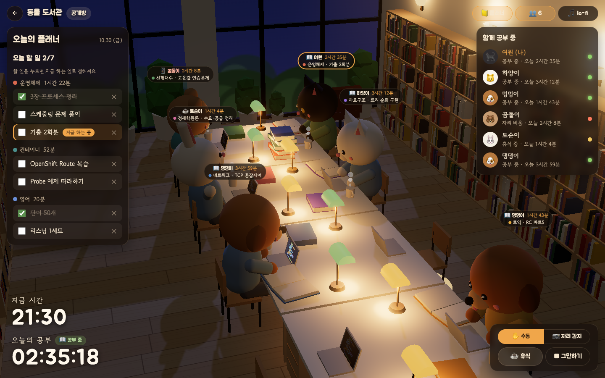

- 학번: 202355536
- 배포 환경: Red Hat Developer Sandbox (OpenShift)
- 구성: Deployment 3개(web, api, redis), Service 3개, Route 1개, ConfigMap 4개, Secret 1개, PVC 1개

---

## 1. 컨테이너 소개

| 항목 | 내용 |
|---|---|
| 서비스 이름 | StudyPals |
| 한 줄 설명 | 3D 공부방에서 캐릭터로 함께 공부하고, 얼굴 감지로 실제 공부시간을 기록하는 서비스 |
| 주제 선정 이유 | 혼자 공부하면 집중이 오래 가지 않는다. 다른 사람이 지금 같이 공부하는 모습을 보여 주는 공간을 만들고 싶었다. 웹·API·DB 3계층이라 ConfigMap, Secret, PVC, Probe를 모두 쓸 수 있는 주제이기도 하다. |

### 주요 기능

| 기능 | 내용 |
|---|---|
| 가입·로그인 | 아이디, 비밀번호, 닉네임으로 가입. 비밀번호는 PBKDF2 해시로 저장 |
| 페이지 | 상단 탭으로 공부방 · 플래너 · 캐릭터 이동. 프로필 메뉴에서 로그아웃 |
| 공부방 목록 | 공개방/비공개방 생성. 비공개방은 6자리 코드로 입장(분당 10회 제한). 정원 4·6·8명 |
| 3D 도서관 | 책상 섬에 마주 보고 앉는 도서관. 빈 자리를 클릭하면 앉고, 다른 사람 상태는 3초마다 반영. 3D 모델 파일 없이 기본 도형과 캔버스 텍스처로 제작 |
| 창밖 시간 | 접속한 사람의 실제 시각에 따라 하늘·해·달·조명이 바뀜. `?time=18:30`으로 원하는 시각 미리보기 가능 |
| 캐릭터 | 곰, 토끼, 검은 고양이, 하얀 고양이, 갈색 강아지. 가입 시 랜덤. 캐릭터 페이지에서 3D 미리보기를 보고 저장 |
| 캐릭터 상태 | 공부 중(타이핑) · 자리 비움(폰 보기) · 휴식(기지개) · 대기(엎드림) |
| 이름표 | 캐릭터 머리 위에 이름, 오늘 공부한 시간, 지금 하는 과목·할 일 표시 |
| 자리 감지 | 1분마다 얼굴 감지. 연속 2번 안 보이면 자리 비움으로 바뀌고 타이머 정지, 다시 보이면 바로 복귀. 영상은 서버로 보내지 않음 |
| 공부시간 | 서버가 하트비트마다 누적. 하루 총합 · 과목별 · 10분 칸별로 저장 |
| 플래너 | 오늘 날짜, 목표 시간과 공부한 시간, TODO, TIMETABLE. 과목별 할 일에서 오늘 할 일을 고르고, 시간표는 10분 칸을 드래그해 과목을 칠함 |
| 공부방 플래너 | 공부방에서 플래너를 열면 오늘 할 일이 과목별로 나옴. 할 일을 누르면 '지금 하는 일'로 정해져 이름표와 공부시간에 반영. 고르지 않으면 시간표의 지금 과목을 따름 |
| lo-fi 음악 | Web Audio로 직접 합성. 음원 파일 없음 |

| 새벽 05:20 | 낮 12:00 | 노을 18:10 | 밤 22:30 |
|---|---|---|---|
| 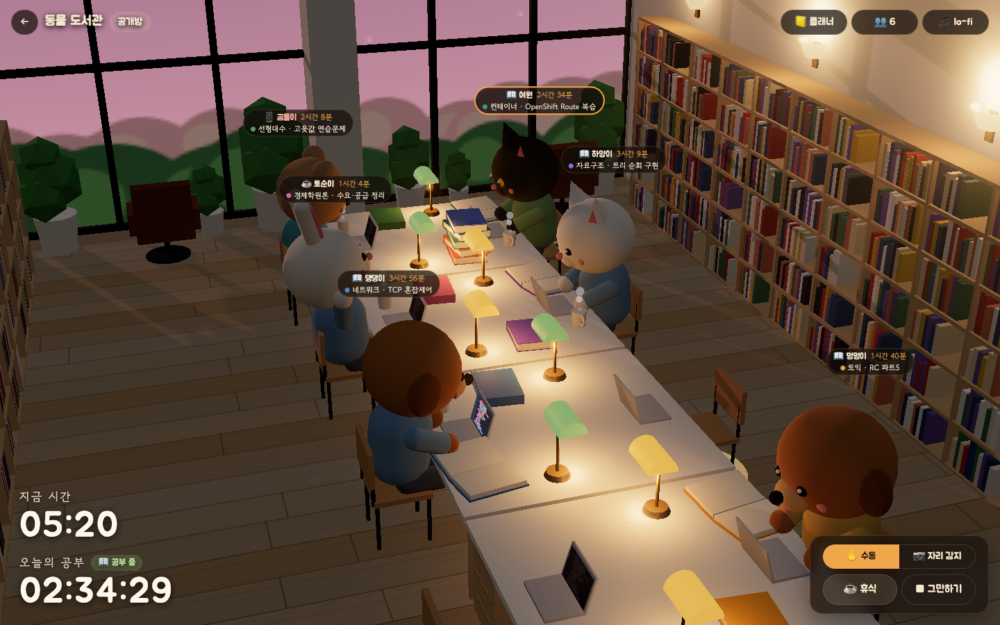 | 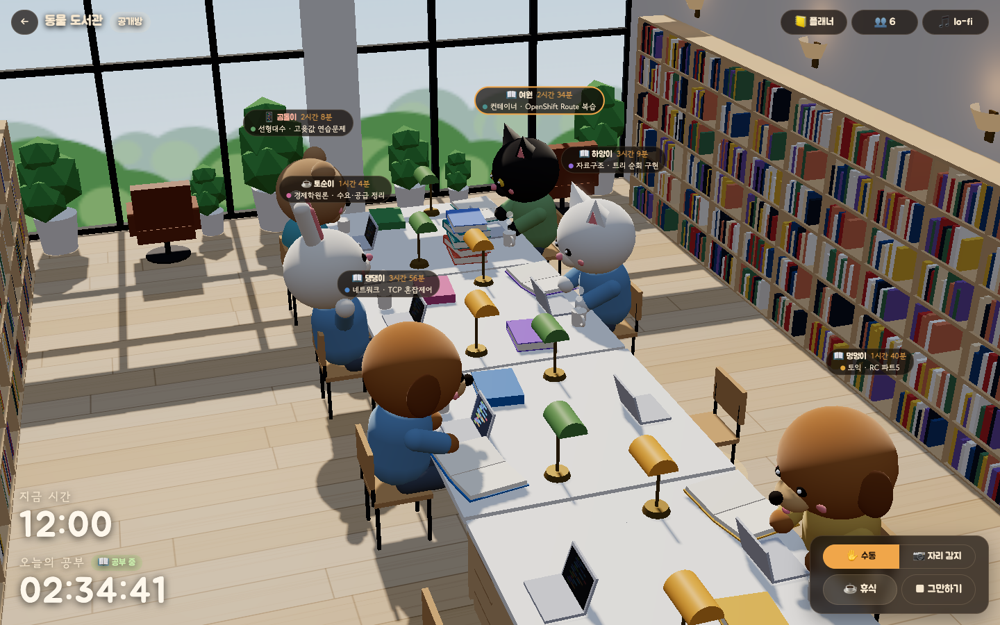 | 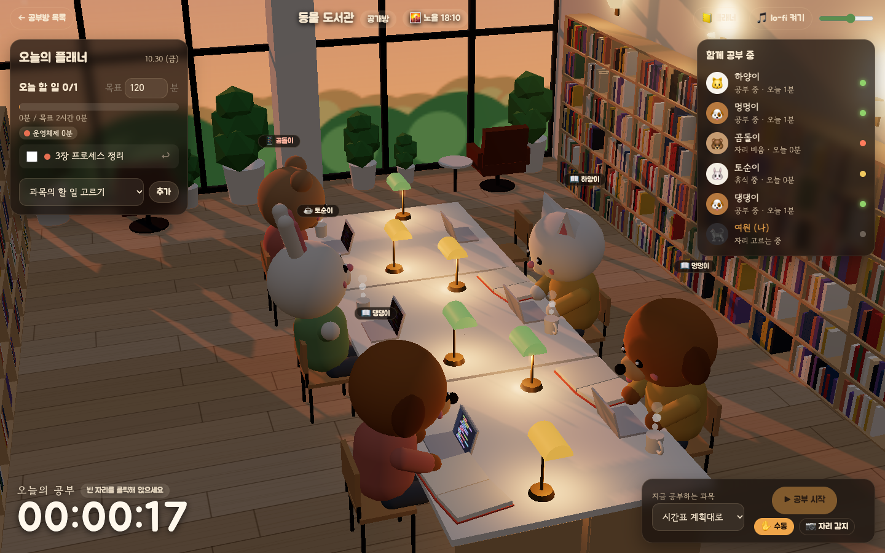 | 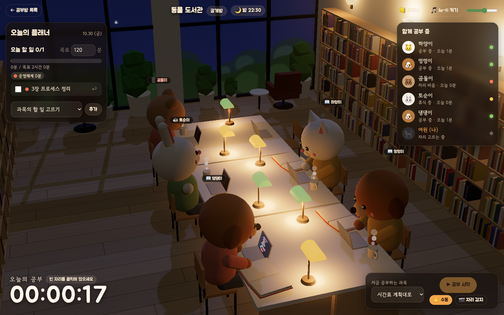 |

| 플래너 | 플래너 시간표 | 캐릭터 | 공부방 목록 |
|---|---|---|---|
| 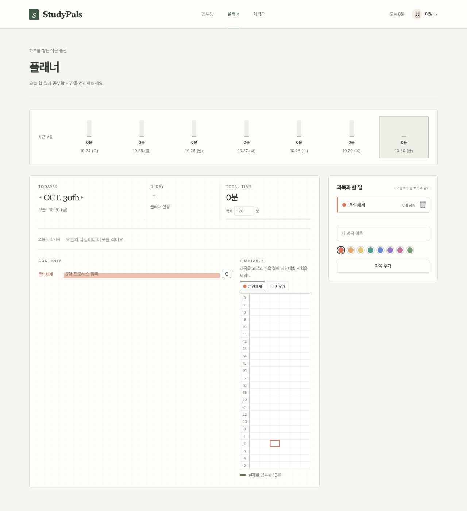 | 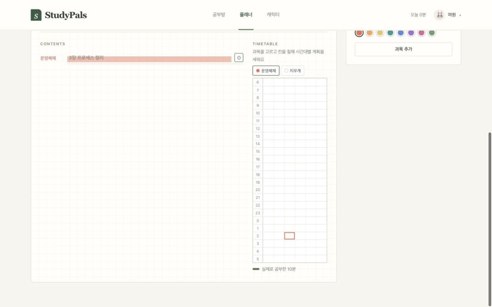 | 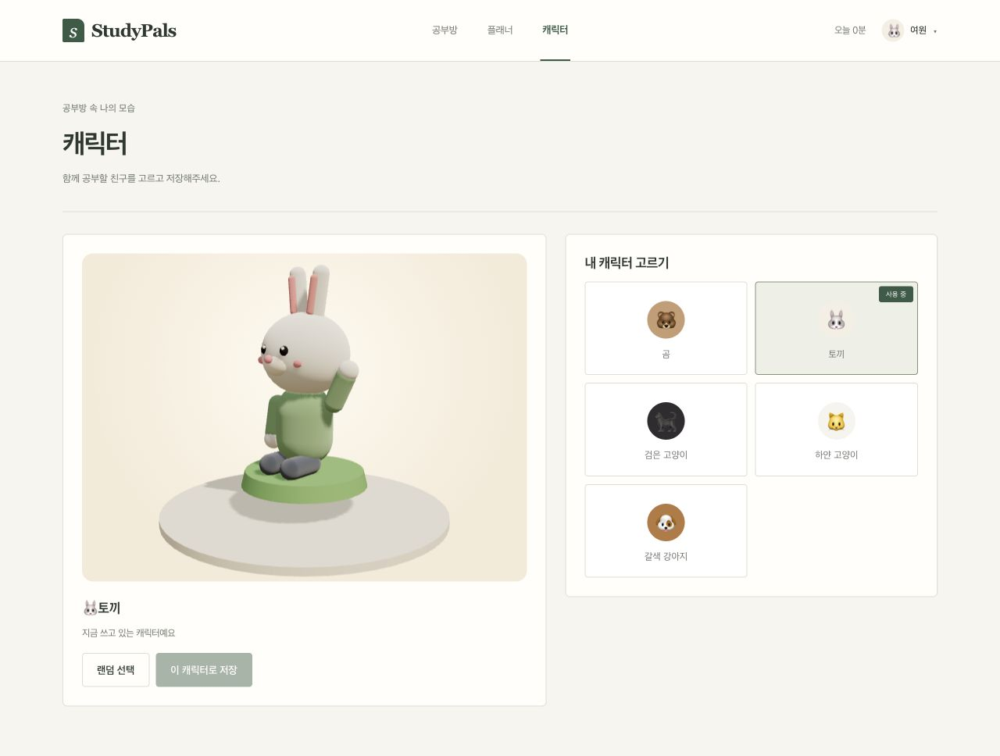 | 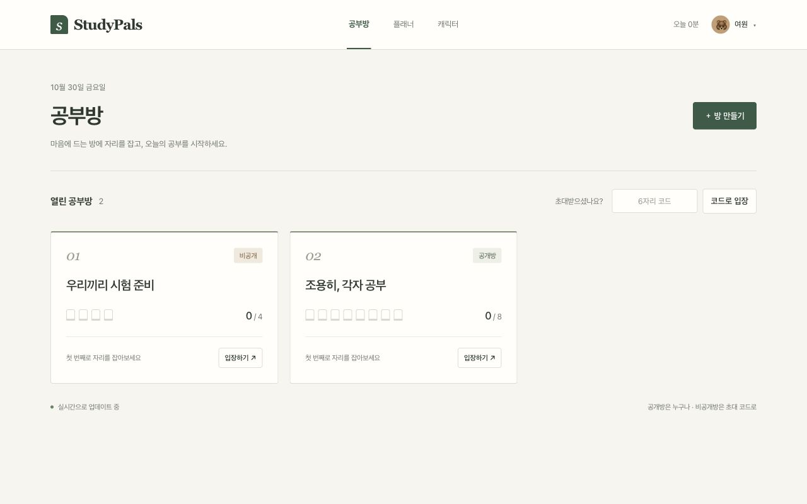 |

---

## 2. 아키텍처


### 요청 흐름

1. 사용자 → Route(TLS 종료) → `studyroom-web` Service → nginx Pod
2. nginx가 ConfigMap으로 마운트한 HTML·JS·CSS를 응답. 3D 렌더링과 얼굴 감지는 브라우저에서 실행
3. `/api/*` 요청은 nginx가 `studyroom-api` Service로 프록시
4. api Pod(Python)가 로그인, 방, 하트비트, 플래너를 처리하고 Redis에 저장
5. Redis는 쓰기를 AOF로 PVC에 기록해 Pod가 다시 떠도 데이터 유지

외부에 열린 것은 web Route 하나. api와 redis는 ClusterIP라 클러스터 안에서만 접근된다.

### 사용한 Object

| 파일 (`k8s/`) | Kind | 이름 | 역할 |
|---|---|---|---|
| `route.yaml` | Route | studyroom | 외부 HTTPS 주소. edge TLS, http는 https로 리다이렉트(카메라 API가 HTTPS에서만 동작). `host`는 자동 생성 |
| `web-deployment.yaml` | Deployment | studyroom-web | nginx. 정적 파일 제공, `/api` 프록시 |
| `web-service.yaml` | Service | studyroom-web | Route → web Pod |
| `api-deployment.yaml` | Deployment | studyroom-api | Python API 서버. 코드는 ConfigMap에서 읽음 |
| `api-service.yaml` | Service | studyroom-api | nginx → api (내부 전용) |
| `redis-deployment.yaml` | Deployment | studyroom-redis | Redis. PVC를 `/var/lib/redis/data`에 마운트, `--appendonly yes` |
| `redis-service.yaml` | Service | studyroom-redis | api → redis (내부 전용) |
| `redis-pvc.yaml` | PersistentVolumeClaim | studyroom-redis-data | Redis 데이터 저장 (1Gi, RWO) |
| `secret.yaml` | Secret | studyroom-secret | `REDIS_PASSWORD`, `SESSION_SECRET`(로그인 쿠키 서명 키) |
| `app-configmap.yaml` | ConfigMap | studyroom-config | Redis 주소·포트, 쿠키 Secure 여부 |
| `web-files-configmap.yaml` | ConfigMap | studyroom-web-files | 프론트엔드 파일 32개 (`src/web/`에서 생성) |
| `nginx-configmap.yaml` | ConfigMap | studyroom-nginx | `/api` 프록시 설정 (`src/nginx/`에서 생성) |
| `api-code-configmap.yaml` | ConfigMap | studyroom-api-code | API 코드 8개 (`src/api/`에서 생성) |

### 주요 설정

| 설정 | 위치 | 이유 |
|---|---|---|
| readiness / liveness 분리 | api | readiness(`/api/healthz`)는 Redis PING까지 확인, liveness(`/api/livez`)는 프로세스만 확인. Redis 장애 때 api가 재시작을 반복하지 않게 함 |
| `redis-cli ping` readiness + TCP liveness | redis | 비밀번호 인증까지 성공해야 Ready |
| `strategy: Recreate` | redis | RWO PVC는 Pod 하나만 붙을 수 있어 RollingUpdate가 멈춤 |
| `replicas: 1` | api | 좌석 배정을 프로세스 안의 Lock으로 처리 |
| `command` 지정 | web, api | UBI s2i 이미지의 기본 CMD가 사용법 출력이라 직접 실행 명령 지정 |
| `resources` | 전체 | Sandbox 할당량 안에서 동작. requests 합계 CPU 0.12코어, 메모리 160Mi |
| `securityContext` | 전체 | `runAsNonRoot`, `allowPrivilegeEscalation: false`, capabilities drop, `seccompProfile: RuntimeDefault` (restricted-v2 SCC) |
| 이름·라벨 | 전체 | 이름은 `studyroom-<component>`, 라벨은 `app: studyroom` + `component: web/api/redis` |

---

## 3. 사용 이미지

직접 빌드한 이미지는 없다. 공개 이미지 3개에 코드와 설정을 ConfigMap으로 넣었다. 셋 다 비루트로 동작하고 1024 이상 포트를 쓴다. Docker Hub 제한을 피하려고 Red Hat 레지스트리와 quay.io 이미지만 썼다.

| 용도 | 이미지 | 포트 | 선택 이유 |
|---|---|---|---|
| web | `registry.access.redhat.com/ubi9/nginx-124:1` | 8080 | UBI 기반이라 임의 UID에서 동작. `nginx.default.d/*.conf`에 프록시 설정 파일 하나만 마운트하면 됨 |
| api | `registry.access.redhat.com/ubi9/python-312:1` | 8080 | 표준 라이브러리만 사용해 배포 시 pip 설치가 필요 없음 |
| db | `quay.io/sclorg/redis-7-c9s:20250108` | 6379 | OpenShift용 이미지. `REDIS_PASSWORD`로 인증 설정, 데이터 경로가 비루트에서 쓰기 가능 |

브라우저 라이브러리(버전 고정)

| 라이브러리 | 버전 | 용도 |
|---|---|---|
| Three.js | `0.169.0` (jsDelivr) | 3D 렌더링, 블룸 후처리 |
| MediaPipe Tasks Vision | `0.10.14` + BlazeFace short range | 얼굴 감지 |

얼굴 감지 모델은 서버가 아니라 브라우저에서 돌린다. Sandbox에 AI 모델 부하를 주지 않고, 카메라 영상도 밖으로 나가지 않는다.

---

## 4. 배포 방법

```bash
cd students/202355536
oc login --token=<토큰> --server=<Sandbox API 주소>   # 웹 콘솔 → Copy login command
oc apply -f k8s/
oc get pods -w        # 3개 Pod가 1/1 Running이 될 때까지 (30초~1분)
oc get route studyroom -o jsonpath='{.spec.host}{"\n"}'
```

### 확인 방법

| 확인 | 방법 | 예상 결과 |
|---|---|---|
| 헬스체크 | `curl https://<host>/api/healthz` | `{"ok": true, "redis": "PONG"}` |
| 웹 접속 | 브라우저로 `https://<host>` | StudyPals 로그인 화면 |
| 공부 | 가입 → 방 만들기 → 빈 자리 클릭 → 공부 시작 | 캐릭터가 앉아 타이핑, 타이머 증가 |
| 함께 공부 | 시크릿 창에서 다른 계정으로 같은 방 입장 | 3초 안에 서로의 캐릭터가 보임 |
| 자리 감지 | 자리 감지 → 카메라 허용 → 화면에서 벗어나기 | 1~2분 뒤 자리 비움, 타이머 정지 |
| 데이터 유지 | `oc delete pod -l component=redis` 후 다시 로그인 | 계정·플래너·공부시간 유지 |

### 코드를 고친 경우

`src/`를 고치면 ConfigMap YAML을 다시 만들고 재배포한다. 스크립트가 ConfigMap 1MiB 제한과 키 이름도 검사한다.

```bash
python3 scripts/gen_configmaps.py
oc apply -f k8s/
oc rollout restart deploy/studyroom-web deploy/studyroom-api
```

---

## 5. 배포 결과

본인 Developer Sandbox에 `oc apply -f k8s/`로 배포했다.

- Route: <https://studyroom-myw0422-dev.apps.rm1.0a51.p1.openshiftapps.com>

### `oc get all`

`studyroom-*`가 이번 과제 리소스다. `mongodb`, `parksmap`, `nationalparks`는 수업 실습 리소스이고, 마지막 줄 `applications ... Forbidden`은 Sandbox 계정 권한 메시지라 배포와 관계없다.

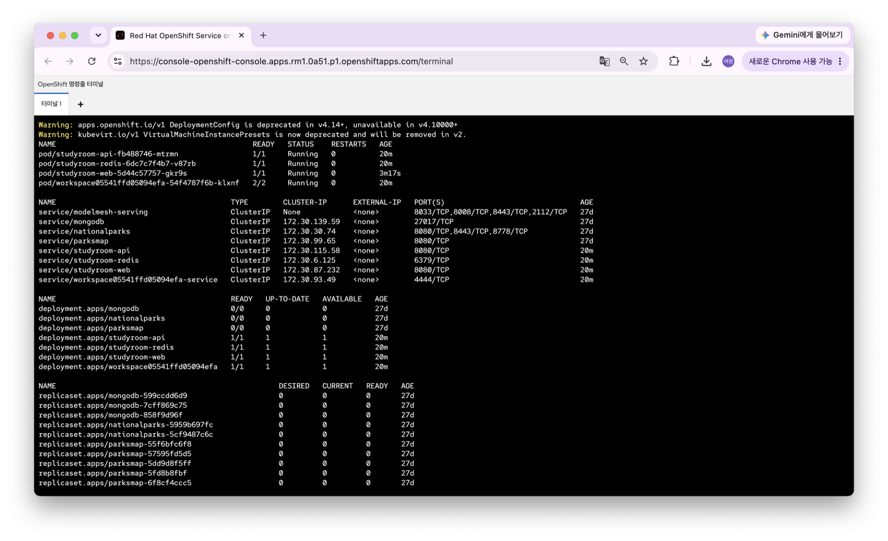
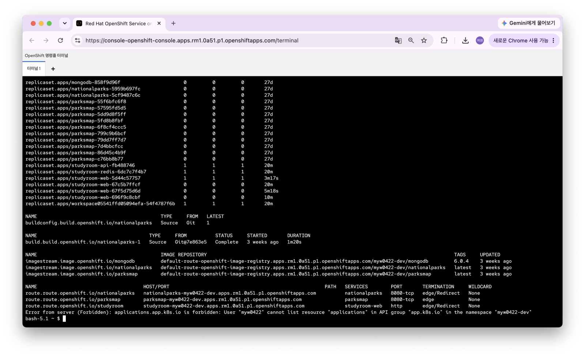
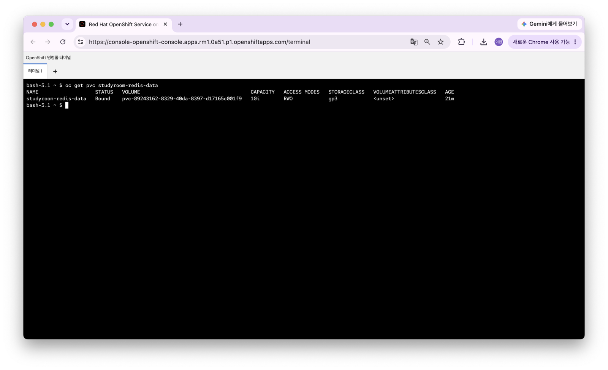

### Route 접속 화면

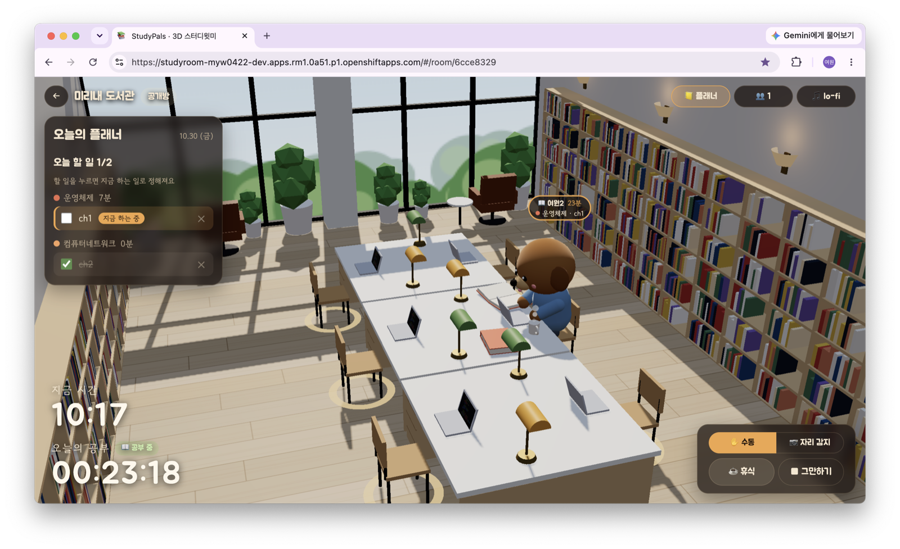

### 확인 내용

```
$ oc get pods
NAME                               READY   STATUS    RESTARTS   AGE
studyroom-api-fb488746-mtrmn       1/1     Running   0          93s
studyroom-redis-6dc7c7f4b7-v87rb   1/1     Running   0          93s
studyroom-web-67c5b7ffcf-9j5q7     1/1     Running   0          93s

$ oc get pvc studyroom-redis-data
NAME                   STATUS   CAPACITY   ACCESS MODES   STORAGECLASS
studyroom-redis-data   Bound    1Gi        RWO            gp3

$ curl -s https://<Route host>/api/healthz
{"ok": true, "redis": "PONG"}
```

- 세 Pod 모두 재시작 없이 `1/1 Running`, PVC는 기본 StorageClass(gp3)로 `Bound`
- 헬스체크로 Route → nginx → api → Redis 경로 확인
- 브라우저에서 가입 → 방 만들기 → 자리 앉기 → 공부 시작, 카메라 자리 감지까지 확인

### 재배포 확인

채점 방식과 같이 모두 지운 뒤 `k8s/`만으로 다시 배포했다.

```
$ oc delete -f k8s/
configmap "studyroom-api-code" deleted ... service "studyroom-web" deleted   (13개 리소스, PVC 포함)
$ oc apply -f k8s/
configmap/studyroom-api-code created ... service/studyroom-web created       (13개 리소스)
$ oc get pods -w
studyroom-api-fb488746-6hq5m       0/1   Running             0   3s    ← Redis 준비 전이라 readiness 대기
studyroom-redis-6dc7c7f4b7-n65ng   0/1   ContainerCreating   0   3s    ← 새 PVC 연결
studyroom-web-67c5b7ffcf-bn2ps     1/1   Running             0   14s
studyroom-redis-6dc7c7f4b7-n65ng   1/1   Running             0   22s
studyroom-api-fb488746-6hq5m       1/1   Running             0   24s

$ curl -s https://<Route host>/api/healthz
{"ok": true, "redis": "PONG"}
```

- 24초 만에 세 Pod 모두 `1/1 Running`
- api가 Redis보다 먼저 떴지만 readiness가 Redis 준비 전까지 트래픽을 막고, 재시작 없이 Ready가 됨

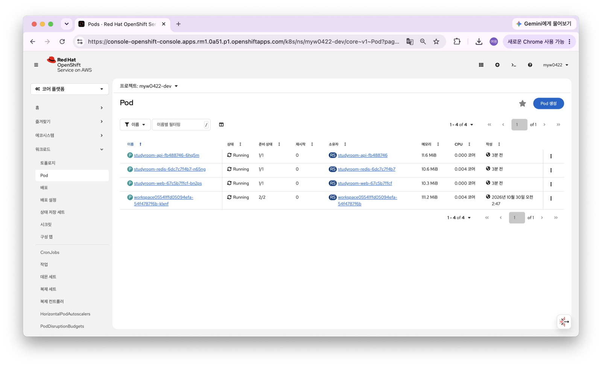

### 로컬 검증

Sandbox에 올리기 전에 k3s(Pod Security `restricted`)에서 `apply → delete → apply`를 확인했다. 세 이미지를 임의 UID(`1000680000:0`)로 실행해 권한 문제가 없는지 확인했고, Redis Pod를 지웠다 다시 띄워 데이터가 남는 것도 확인했다.

---

## 6. 어려웠던 점

| 문제 | 원인 | 해결 |
|---|---|---|
| nginx 컨테이너가 바로 종료 | UBI s2i 이미지의 기본 CMD가 사용법 출력 스크립트 | `command: ["nginx", "-g", "daemon off;"]` 지정 |
| nginx가 `host not found in upstream`으로 종료 | 시작할 때 `proxy_pass` 호스트를 DNS로 찾는데 api Service가 아직 없음 | `oc apply -f k8s/`는 파일명 순서라 `api-service.yaml`이 먼저 생성됨을 확인. 실패해도 재시작으로 회복 |
| api Pod 삭제에 30초 걸림 | Python이 PID 1이면 SIGTERM 기본 종료가 동작하지 않음 | `signal.signal(SIGTERM, …)`으로 직접 종료 |
| Redis보다 api가 먼저 뜰 수 있음 | 시작 순서 보장 불가 | 첫 요청 때 Redis에 연결하고 끊기면 재연결. readiness만 Redis 상태를 반영 |
| Google 로그인 포기 | OAuth는 등록한 주소에서만 동작하는데 채점 환경의 Route 주소가 다름 | 아이디·비밀번호 가입으로 변경. 비밀번호는 PBKDF2, 세션은 Secret 키로 HMAC 서명 |
| 이미지 빌드 없이 코드 배포 | 과제 조건 | 소스를 ConfigMap으로 마운트. 하위 폴더를 못 쓰고 1MiB 제한이 있어 파일을 평면으로 두고 생성 스크립트에서 크기 검사 |
| 노트북 카메라에서 얼굴을 못 찾음 | 16:9 영상이 정사각형 모델 입력에서 찌그러짐 | 가운데를 정사각형으로 잘라 넣고, 감지 점수를 화면에 표시 |
| 배포 후 예전 JS가 섞임 | nginx가 캐시 헤더 없이 JS를 제공 | html·js·css에 `Cache-Control: no-cache` 추가 |

---

## 7. AI · 참고자료 활용 내역

| 도구 | 용도 |
|---|---|
| ChatGPT | 서비스 아이디어 기획 (컨셉, 기능 목록, 범위) |
| Claude Code (Claude Opus 5.5) | 과제 조건 검토, 구조 설계, API·프론트엔드·YAML·README 초안, 화면 디자인 수정, 로컬 검증 자동화 |
| Codex | 과제 안내와 제출물 대조, 일반 페이지 디자인 수정, YAML 점검, 로컬 동작 검증 |

AI가 만든 YAML은 로컬 k3s와 본인 Sandbox에 직접 배포해 확인했다(5장). 각 항목의 의미는 2장 표에 정리했다.

### 참고 문서

- [OpenShift Routes - Secured routes (edge)](https://docs.openshift.com/container-platform/latest/networking/routes/secured-routes.html)
- [OpenShift - Managing security context constraints](https://docs.openshift.com/container-platform/latest/authentication/managing-security-context-constraints.html)
- [Kubernetes - Liveness, Readiness and Startup Probes](https://kubernetes.io/docs/tasks/configure-pod-container/configure-liveness-readiness-startup-probes/)
- [Kubernetes - ConfigMaps](https://kubernetes.io/docs/concepts/configuration/configmap/)
- [sclorg/redis-container](https://github.com/sclorg/redis-container) · [sclorg/nginx-container](https://github.com/sclorg/nginx-container)
- [Redis persistence (AOF)](https://redis.io/docs/latest/operate/oss_and_stack/management/persistence/)
- [MediaPipe Face Detector (Web)](https://ai.google.dev/edge/mediapipe/solutions/vision/face_detector/web_js)
- [Three.js documentation](https://threejs.org/docs/)
